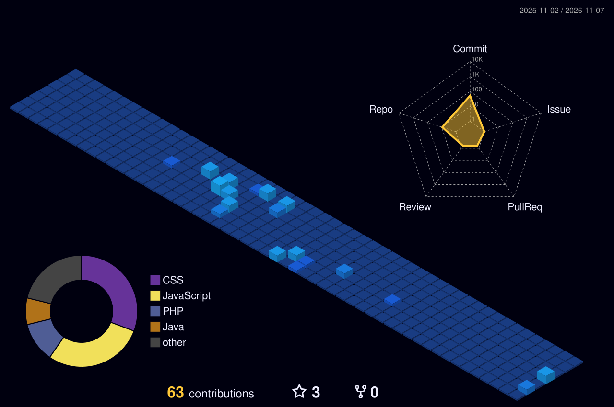

<!-- ============ BANNER ============ -->
<div align="center">


<!-- Typing: alterna entre especialidades. Máx. 3-4 linhas para não cansar -->
<a href="https://git.io/typing-svg">
  
</a>

<br/><br/>

<!-- ============ REDES ============ -->
<!-- Confirme os links antes de publicar -->
<a href="https://linkedin.com/in/vitor-hugo-vaccari"></a>
<a href="mailto:luvaccari88@gmail.com"></a>
<a href="https://github.com/VitorHugoVaccari?tab=repositories"></a>

</div>

<br/>

<!-- ============ SOBRE ============ -->
## `> sobre`

<table>
<tr>
<td width="62%" valign="top">

```java
public class VitorHugo {

    String foco     = "Back-end com Java e Spring Boot";
    String base     = "PHP (CodeIgniter 4), MySQL, JavaScript";
    String formacao = "Sistemas de Informação (Estácio) + Técnico em Informática para Internet (SENAI)";
    String local    = "Nova Lima, MG";
    String status   = "Buscando primeiro estágio em desenvolvimento";
}
```

</td>
<td width="38%" valign="top">

**Agora**

- Estudando Java e Spring Boot (bootcamp Itaú + DIO)
- Aprofundando SQL e modelagem de dados
- Praticando Git/GitHub em projetos autorais

<!-- Quando tiver um projeto em Spring Boot, adicione aqui -->

</td>
</tr>
</table>

<!-- ============ DIVISOR 1 ============ -->


<!-- ============ STACK ============ -->
## `> stack`

| | |
|:--|:--|
| **Back-end** |  |
| **Em estudo** |  |
| **Banco de dados** |  |
| **Front-end** |  |
| **Ferramentas** |  |

<br/>

<!-- ============ PROJETOS ============ -->
## `> projetos`

| Projeto | O que resolve | Stack |
|:--|:--|:--|
| **[Controle de Acesso de Visitantes](https://github.com/VitorHugoVaccari/visitor-access-control)** | Entrada e saída de visitantes técnicos com autenticação, CRUD, histórico de acessos e dashboard de visitantes ativos. |    |
| **[Calculadora de Rescisão Trabalhista](https://github.com/VitorHugoVaccari/calculadora-rescisao)** | Simula verbas rescisórias pela CLT: férias proporcionais, 13º, FGTS e aviso prévio. Online via GitHub Pages. |    |

<!-- Quando existir, adicione uma linha com o projeto Java/Spring Boot. É a linha mais importante do seu README. -->

<!-- ============ DIVISOR 2 ============ -->


<!-- ============ ATIVIDADE ============ -->
## `> atividade`

<div align="center">

<!-- 3D animado: gerado pela GitHub Action (ver workflow). Caminho relativo ao repositório do perfil -->


<br/><br/>


<br/><br/>


</div>

<br/>

<!-- ============ RODAPÉ ============ -->
